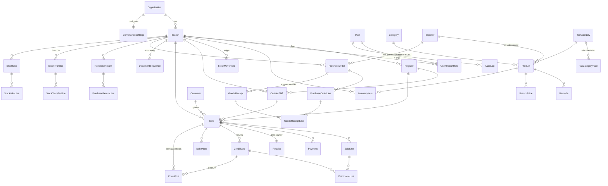

# Database structure

PostgreSQL 16 in production (SQLite is dev-only and has no triggers). Django migrations live in each app's `migrations/`.
Conventions:
- **Money = `BigInteger` paisa** (column names end in `_paisa`).
- Rates are `Decimal(5,2)` percent.
- Basis points (`_bp`) = 1/100 of a percent.
- Dates: `DateTimeField`s are UTC-aware. BS dates are stored as `CHAR(10)` `YYYY.MM.DD` (`*_bs`).
- Fiscal year label `2083-84`.

Generated from the models on 2026-10-25. Regenerate the column list with the `apps.get_models()` snippet at the end of this file.

## ER overview



## Tables

### tenancy
| Table | Key columns | Notes |
|---|---|---|
| `tenancy_organization` | name, name_np, **pan**, address, phone, email, vat_registered, business_type | The seller printed on invoices. One per deployment. |
| `tenancy_branch` | org_id, name, **code** (unique), timezone, address, phone, is_active | `code` prefixes every document number. |
| `tenancy_register` | branch_id, code, name, printer_driver, printer_config (JSON), is_active | UNIQUE(branch, code). Driver: browser / network_escpos / usb_bridge. |

### accounts
| Table | Key columns | Notes |
|---|---|---|
| `accounts_user` | Django AbstractUser | Deactivate (`is_active=false`); never delete. |
| `accounts_userbranchrole` | user_id, branch_id (NULL = org role), role | UNIQUE(user, branch); partial UNIQUE(user) where branch IS NULL. |

### catalog
| Table | Key columns | Notes |
|---|---|---|
| `catalog_category` | name, parent_id | Tree. |
| `catalog_supplier` | name, **pan**, phone, email, address | PAN feeds the purchase book. |
| `catalog_product` | **sku** (unique), name, category_id, supplier_id, unit, cost_price_paisa, sale_price_paisa, tax_rate (cache), tax_inclusive, **tax_category_id**, hs_code, excise_rate, input_credit_blocked_pct, is_active, archived_at | Soft-deleted via `archived_at`. `cost_price` is only the purchase default; the real cost is in InventoryItem. |
| `catalog_barcode` | product_id, **code** (unique), type, pack_qty | Scanning a case barcode adds `pack_qty` units. |
| `catalog_branchprice` | branch_id, product_id, sale_price_paisa | UNIQUE(branch, product). |

### inventory
| Table | Key columns | Notes |
|---|---|---|
| `inventory_inventoryitem` | branch_id, product_id, **quantity_on_hand** (cache), reorder_point, reorder_qty, **weighted_avg_cost_paisa**, allow_negative | UNIQUE(branch, product). Always locked via `lock_items` in product_id order. |
| `inventory_stockmovement` | branch_id, product_id, **type**, qty (signed), unit_cost_paisa, ref, ref_type, at, by_id, reason | The ledger. Types: purchase_in, sale_out, return_in, adjust_in, adjust_out, transfer_out, transfer_in, stocktake_adjust, purchase_return_out. Indexed (branch, product) and (branch, at). |
| `inventory_stocktransfer` / `…line` | from/to branch, status (draft→in_transit→received/cancelled); qty_sent, qty_received, unit_cost_paisa, variance_reason | Visible to both branches. |
| `inventory_stocktake` / `…line` | status, scope (JSON); system_qty (snapshot), counted_qty, variance, reason | UNIQUE(stocktake, product). |

### sales (★ = append-only once issued)
| Table | Key columns | Notes |
|---|---|---|
| `sales_customer` | branch_id (NULL = org-wide), name, phone, address, tax_id | Optional reference only. |
| `sales_cashiershift` | register_id, cashier_id, status, opening/counted/expected cash, variance | Partial UNIQUE(register) where status='open'. |
| ★ `sales_sale` | branch, register, shift, cashier, customer, **status** (open/paid/voided/payment_orphan), **invoice_type** (full/abbreviated), buyer_name/address/pan, payment_method; money: subtotal, discount_total, tax_total, excise_total, hst_total, esf_total, digital_vat_discount, round_adjust, **total**; CBMS buckets: taxable_sales_vat, excisable_amount, taxable_sales_hst, amount_for_esf, tax_exempted_sales, zero_rated_sales; dates: opened_at, paid_at, **transaction_at/_bs**, **issued_at/_bs**, voided_at, void_reason; offline flags (offline, offline_created_at, provisional_ref); idempotency_key (unique), payment_ref, expires_at; stock_conflict + resolution; needs_review; **fiscal_year, series, receipt_seq, receipt_number** | UNIQUE(branch, fiscal_year, series, receipt_seq) where receipt_seq IS NOT NULL. "Issued" = `receipt_number <> ''`. Identity: subtotal − discount + tax + excise + hst + esf − digital + round_adjust = total. |
| ★ `sales_saleline` | sale_id, product_id, product_name, hs_code, qty, unit_price_paisa, discount type/value/reason, line_discount, sale_discount_share, **line_total**, tax_category_code, tax_kind, tax_rate, tax_inclusive, tax_amount, excise_rate/paisa, levy_type/rate/paisa, unit_cost_paisa (COGS snapshot) | Frozen at sale time. |
| ★ `sales_payment` | sale_id, method (cash/fonepay/card/wallet/bank), amount, tendered, change, ref, fonepay_prn (unique), fonepay_trx_id, fonepay_paid, status | |
| `sales_receipt` | sale_id (1:1), number, print_count, printed_at | The trigger allows only print_count/printed_at to change, and print_count can only go up. |
| ★ `sales_printlog` | doc_type (invoice/credit_note/debit_note), doc_id, document_number, **kind** (original/copy/delivery), copy_no, by, at | The print-once evidence. |
| `sales_documentsequence` | branch_id, **register_key** (0 = branch series), fiscal_year, **doc_type** (invoice/credit_note/debit_note/purchase_return), next_number | UNIQUE(branch, register_key, fiscal_year, doc_type). Locked `FOR UPDATE` when allocating; gapless. |
| ★ `sales_creditnote` / `…line` | original_sale_id, number (`CN-…`), seq, series, fiscal_year, issued_bs, reason, approved_by, total/taxable/tax/excise/levy, CBMS buckets, refund_method; lines: original_sale_line_id, qty, line_total, tax, excise, levy | UNIQUE(branch, fiscal_year, series, seq). |
| ★ `sales_debitnote` | original_sale_id, number (`DN-…`), taxable, tax_rate, tax, total, issued_bs, reason | UNIQUE(branch, fiscal_year, seq). |
| `sales_heldcart` | register, cashier, label, cart (JSON) | Hold/recall; deletable. |
| `sales_fonepaymismatch` | prn, kind, detail, resolved | From the daily reconciliation. |
| `sales_mockfonepaytransaction` | prn, amount, paid, status | Dev mock gateway only. |

### purchasing
| Table | Key columns | Notes |
|---|---|---|
| `purchasing_purchaseorder` / `…line` | supplier, status (draft/ordered/partial/received/cancelled); qty_ordered, qty_received, unit_cost_paisa | Not a payables ledger. |
| ★ `purchasing_goodsreceipt` / `…line` | po_id, received_bs, **supplier_invoice_ref/date/_bs**, is_import, taxable, exempt, vat, claimable_vat; lines: qty, unit_cost, vat_rate, tax_kind, vat, input_credit_blocked_pct | One purchase-book row per receipt. |
| ★ `purchasing_purchasereturn` / `…line` | supplier, goods_receipt (opt), number (`PR-…`), issued_bs, supplier_note_ref, reason, taxable, vat, claimable_vat | Stock out + input VAT reversal. |

### compliance
| Table | Key columns | Notes |
|---|---|---|
| `compliance_taxcategory` | **code** (unique), name, kind (standard/reduced/zero/exempt), levy_type (''/hst/esf), is_active | Seeded: VAT13, VAT5, ZERO, EXEMPT, HST5. |
| `compliance_taxcategoryrate` | category_id, **effective_from**, vat_rate, levy_rate, note | UNIQUE(category, effective_from). Add rows; never edit history. |
| `compliance_compliancesettings` | org_id (1:1), invoice_series, abbreviated/delivery limits, require_buyer_pan_over_limit, digital_vat_discount_*, cbms_enabled/base_url/username/**password_enc** (Fernet), realtime window, paused_reason, thresholds, excess_stock_fine_bp | `get_settings()` creates it if missing. |
| `compliance_cbmspost` | **key** (unique: `bill:<sale>`, `billreturn:cn:<id>`, `billreturn:cancel:<sale>`), doc_type, branch, sale, credit_note, document_number, issued_at, payload (no credentials), status (pending/synced/failed), attempts, last_code, last_error, next_attempt_at, isrealtime, synced_at | The outbox. Index (status, next_attempt_at). |
| `compliance_mockcbmsrecord` | endpoint, document_number, payload | What the `mock://` double received. |

### admin_extras
| Table | Key columns | Notes |
|---|---|---|
| ★ `admin_extras_auditlog` | at, at_bs, user, branch, action, object_type, object_id, **data**, **changes** (`{field: [before, after]}`), ip | Business events (`log_action`) plus automatic diffs on audited models. Never updated or deleted. |

## Database-level protection (PostgreSQL; `compliance/migrations/0003`)
| Trigger function | Applied to | Effect |
|---|---|---|
| `ims_block_delete()` | sale, saleline, payment, receipt, creditnote(+line), debitnote, printlog, auditlog, goodsreceipt(+line), purchasereturn(+line) | `BEFORE DELETE` → exception |
| `ims_block_update()` | creditnote(+line), debitnote, printlog, auditlog, goodsreceipt(+line), purchasereturn(+line) | `BEFORE UPDATE` → exception |
| `ims_guard_issued_sale()` | sales_sale | Once `receipt_number <> ''`, only the status, void columns, conflict columns, needs_review and stock_conflict may change. Voided can't go back to paid. |
| `ims_guard_issued_child()` | saleline, payment | No updates once the parent sale is issued |
| `ims_guard_receipt()` | sales_receipt | Only print_count (increasing) and printed_at |

`TRUNCATE` is not blocked: the Django test runner uses it. Production roles shouldn't have TRUNCATE.

## Auditor views
`cbms_bill_view` (one row per issued invoice with every CBMS field plus sync status) and `cbms_return_view` (credit notes). These are **materialized** on Postgres (refresh with `manage.py refresh_auditor_views`, nightly cron) and plain views on SQLite.

## Example queries
```sql
-- Is the cached stock right? (also: manage.py reconcile_stock)
SELECT i.branch_id, i.product_id, i.quantity_on_hand, COALESCE(SUM(m.qty),0) AS ledger
FROM inventory_inventoryitem i LEFT JOIN inventory_stockmovement m
  ON m.branch_id=i.branch_id AND m.product_id=i.product_id
GROUP BY 1,2,3 HAVING i.quantity_on_hand <> COALESCE(SUM(m.qty),0);

-- Invoice series gaps for a branch/fiscal year
SELECT s.n FROM generate_series(1,(SELECT next_number-1 FROM sales_documentsequence
  WHERE branch_id=1 AND register_key=0 AND fiscal_year='2083-84' AND doc_type='invoice')) s(n)
WHERE NOT EXISTS (SELECT 1 FROM sales_sale WHERE branch_id=1 AND fiscal_year='2083-84' AND series='' AND receipt_seq=s.n);

-- CBMS backlog
SELECT status, count(*) FROM compliance_cbmspost GROUP BY status;
```

## Regenerating the column list
```bash
cd backend && .venv/bin/python manage.py shell -c "
from django.apps import apps
for m in apps.get_models():
    print(m._meta.db_table, [f.name for f in m._meta.concrete_fields])"
```
