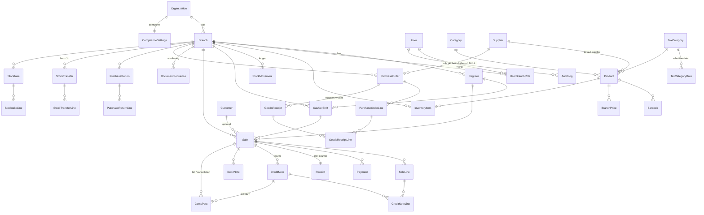

# Database

PostgreSQL 16 in production (`docker-compose.yml`, WAL archiving on). SQLite is the dev fallback when `DATABASE_URL` is unset; it has **no triggers and no row locks**, so run `backend/scripts/test_with_postgres.py` before every release.

Checked against the live models on 2026-10-26: **37 application tables, 17 migrations, no pending model changes** (`makemigrations --check` clean). Regenerate the column list with the snippet at the end.

## Status at a glance

| Area | Built ✅ | Left ❌ |
|---|---|---|
| Tenancy & access | Organization, branches, registers; users with one role per branch (or org-wide); every write to master data audited | Roles live in code (`accounts/roles.py`), not tables, so custom roles need a schema change. No Postgres row-level security. |
| Catalog | Products, multi-barcode with pack sizes, branch prices, categories, suppliers, effective-dated tax categories | Batch/lot and expiry dates, units with conversion (box ↔ piece), price history |
| Stock | Per-branch stock cache + signed movement ledger, weighted-average cost, transfers, stocktakes, reorder levels | **Quantities are integers**: weighed goods (0.735 kg) need decimal qty across sales, stock and pricing. No batch/expiry stock. |
| Sales & IRD | Sales, lines, payments, gapless per-branch/per-register numbering, credit/debit notes, print-once log, CBMS outbox, append-only enforcement (model + triggers), auditor views | Foreign-currency sales (no currency/rate columns). Customer credit (receivables) and loyalty. |
| Purchasing | POs, goods receipts as purchase-book rows (VAT, claimable VAT, imports), purchase returns with `PR-` numbers | Supplier payables ledger (amount owed, payments to suppliers) |
| Operations | Nightly `pg_dump` (90 daily / ~7 years monthly), WAL archive for point-in-time recovery, weekly restore drill (Docker `backup` service), `reconcile_stock`, `refresh_auditor_views`, least-privilege app role `ims_app` | Partitioning/archiving plan for the largest tables. Backup encryption and off-site copy. |

## Conventions
- **Money = `BigInteger` paisa**; column names end in `_paisa`. Never floats.
- Rates are `Decimal(5,2)` percent. Basis points (`_bp`) = 1/100 of a percent.
- `DateTimeField`s are UTC-aware. BS dates are `CHAR(10)` `YYYY.MM.DD` (`*_bs`). Fiscal year label `2083-84`.
- Nothing financial is deleted: products are archived (`archived_at`), users deactivated (`is_active`), invoices cancelled (status + reason).
- **Value ranges** are checked by model validators (no database constraint, so no schema change): money settings and prices 0 to Rs 100 billion (`10**13` paisa), VAT/levy rates 0–100 %, basis points ≤ 10000, reorder point/quantity ≥ 0, barcode `pack_qty` 1–100000. Request numbers are read through `ims.api.to_int` with the same caps.
- ★ in the tables below = **append-only once issued** (model guard `compliance.appendonly.AppendOnlyModel` + Postgres triggers).

## ER overview



## Businesses (multi-business, 2026-11-07)
`tenancy_organization` is a separately registered business (own PAN). Added: `code` (unique slug), `trade`, `is_active`. Business-owned rows carry `org_id`: `catalog_category`, `catalog_supplier`, `catalog_product` (UNIQUE `(org, sku)`), `catalog_barcode` (copied from its product; UNIQUE `(org, code)`), `sales_customer`, `accounts_userbranchrole` (UNIQUE `(user, org)` where branch IS NULL; branch roles take the branch's org). Branch-scoped tables reach the business through `branch.org`. New: `tenancy_businessrules` (one per org: cash rounding, cashier discount limit, return approval threshold, stocktake variance), `admin_extras_systemsettings` (one row: group name, roles needing a sign-in code, lockout limits, SMTP with encrypted password), `accounts_user.is_platform_admin`. Migrations back-filled existing rows to the first business and copied the old `EMAIL_*`/`IMS_*` env values into these tables.

## Tables

### tenancy (3)
| Table | Columns | Constraints / notes |
|---|---|---|
| `tenancy_organization` | name, name_np, **pan**, address, phone, email, vat_registered, business_type | The seller printed on invoices. One per deployment. |
| `tenancy_branch` | org_id, name, **code** (unique), timezone, address, phone, is_active | `code` prefixes every document number. |
| `tenancy_register` | branch_id, code, name, printer_driver, printer_config (JSON), is_active | UNIQUE(branch, code). `printer_driver` is the register *default* (browser / HTTP endpoint); USB/serial printers are paired per till in the browser, not stored here. |

### accounts (2)
| Table | Columns | Constraints / notes |
|---|---|---|
| `accounts_user` | Django AbstractUser (username, names, email, password hash, is_active, last_login…) | Deactivate, never delete. |
| `accounts_userbranchrole` | user_id, branch_id (NULL = org role), role | `uniq_user_branch_role` UNIQUE(user, branch); `uniq_user_org_role` UNIQUE(user) WHERE branch IS NULL. Role → permissions map is in code and served by `GET auth/roles`. |

### catalog (5)
| Table | Columns | Constraints / notes |
|---|---|---|
| `catalog_category` | name, parent_id | Tree. |
| `catalog_supplier` | name, **pan**, phone, email, address | PAN feeds the purchase book. |
| `catalog_product` | **sku** (unique), name, category_id, supplier_id, unit, cost_price_paisa, sale_price_paisa, tax_rate (cache), tax_inclusive, **tax_category_id**, hs_code, excise_rate, input_credit_blocked_pct, image_key, is_active, archived_at, created_at, updated_at | Archived, never deleted. `cost_price` is only the purchase default; real cost is `InventoryItem.weighted_avg_cost_paisa`. |
| `catalog_barcode` | product_id, **code** (unique), type (ean13/ean8/upca/code128/other), pack_qty | Scanning a case barcode adds `pack_qty` units. In-store codes generated by the app are EAN-13 starting with `2`; uniqueness is this constraint. |
| `catalog_branchprice` | branch_id, product_id, sale_price_paisa | UNIQUE(branch, product). |

### inventory (6)
| Table | Columns | Constraints / notes |
|---|---|---|
| `inventory_inventoryitem` | branch_id, product_id, **quantity_on_hand** (cache), reorder_point, reorder_qty, **weighted_avg_cost_paisa**, allow_negative | UNIQUE(branch, product); index (branch, product). Locked via `lock_items` in product_id order. |
| `inventory_stockmovement` | branch_id, product_id, **type**, qty (signed), unit_cost_paisa, ref, ref_type, at, by_id, reason | The ledger; every stock change writes one. Types: purchase_in, sale_out, return_in, adjust_in, adjust_out, transfer_out, transfer_in, stocktake_adjust, purchase_return_out. Indexes (branch, product), (branch, at). |
| `inventory_stocktransfer` | from_branch_id, to_branch_id, status (draft→in_transit→received / cancelled), started_at, by_id, dispatched_at, received_at, received_by_id, note | Visible to both branches. |
| `inventory_stocktransferline` | transfer_id, product_id, qty_sent, qty_received, unit_cost_paisa, variance_reason | |
| `inventory_stocktake` | branch_id, status, started_at, finished_at, by_id, scope (JSON) | |
| `inventory_stocktakeline` | stocktake_id, product_id, system_qty (snapshot), counted_qty, variance, reason | UNIQUE(stocktake, product). |

### sales (16)
| Table | Columns | Constraints / notes |
|---|---|---|
| `sales_customer` | branch_id (NULL = org-wide), name, phone, email, address, tax_id, created_at | Reference only; no balances. |
| `sales_cashiershift` | branch_id, register_id, cashier_id, status, opened_at, opening_cash_paisa, closed_at, counted_cash_paisa, expected_cash_paisa, variance_paisa, closed_offline | `one_open_shift_per_register` UNIQUE(register) WHERE status='open'. |
| ★ `sales_sale` | **who/where:** branch, register, shift, cashier, customer · **state:** status (open/paid/voided/payment_orphan), invoice_type (full/abbreviated), buyer_name/address/pan, payment_method · **money:** subtotal, discount_total, tax_total, excise_total, hst_total, esf_total, digital_vat_discount, round_adjust, **total** · **CBMS buckets:** taxable_sales_vat, excisable_amount, taxable_sales_hst, amount_for_esf, tax_exempted_sales, zero_rated_sales · **discount:** sale_discount_type/value/reason, discount_approved_by, tax_allocation_method · **dates:** opened_at, paid_at, transaction_at/_bs, issued_at/_bs, voided_at, voided_by, void_reason · **offline:** offline, offline_created_at, provisional_ref · **idempotency/payment:** idempotency_key (unique), payment_ref, expires_at · **review:** stock_conflict, conflict_resolution, conflict_resolved_by/at, needs_review · **numbering:** fiscal_year, series, receipt_seq, receipt_number | `uniq_invoice_number_in_series` UNIQUE(branch, fiscal_year, series, receipt_seq) WHERE receipt_seq IS NOT NULL. Indexes (branch, opened_at), (branch, paid_at), (branch, issued_at), (status, expires_at). "Issued" = `receipt_number <> ''`. Identity: subtotal − discount + tax + excise + hst + esf − digital + round_adjust = total. |
| ★ `sales_saleline` | sale_id, product_id, product_name, hs_code, qty, unit_price_paisa, discount_type/value/reason, line_discount, sale_discount_share, **line_total**, tax_category_code, tax_kind, tax_rate, tax_inclusive, tax_amount, excise_rate/paisa, levy_type/rate/paisa, unit_cost_paisa (COGS snapshot) | Frozen at sale time. |
| ★ `sales_payment` | sale_id, method (cash/fonepay/card/wallet/bank), amount, tendered, change, ref, fonepay_prn (unique), fonepay_trx_id, fonepay_paid_paisa, status, created_at, expires_at | |
| `sales_receipt` | sale_id (1:1), number, format, printed_at, print_count | Trigger allows only print_count (increasing) and printed_at to change. |
| ★ `sales_printlog` | doc_type (invoice/credit_note/debit_note), doc_id, document_number, kind (original/copy/delivery), copy_no, by_id, at | Print-once evidence. Index (doc_type, doc_id). |
| `sales_documentsequence` | branch_id, **register_key** (0 = branch series), fiscal_year, **doc_type** (invoice/credit_note/debit_note/purchase_return), next_number | UNIQUE(branch, register_key, fiscal_year, doc_type). Locked `FOR UPDATE` by `sales.numbering.allocate`; gapless. |
| ★ `sales_creditnote` | branch, register, original_sale, cashier, shift, approved_by, total/taxable/tax/excise/levy, taxable_sales_vat, tax_exempted_sales, refund_method, fiscal_year, series, seq, number (`CN-…`), at, issued_bs, reason | UNIQUE(branch, fiscal_year, series, seq). |
| ★ `sales_creditnoteline` | credit_note_id, original_sale_line_id, qty, unit_price, line_total, tax, excise, levy | |
| ★ `sales_debitnote` | branch, original_sale, by, taxable, tax_rate, tax, total, fiscal_year, seq, number (`DN-…`), at, issued_bs, reason | UNIQUE(branch, fiscal_year, seq). |
| `sales_registerdisplay` | register (1:1), code_hash + code_expires_at, token_hash (SHA-256), paired_at, last_seen_at, state (JSON), seq, changed_at, sent_at | A till's tablet customer display. Transient, not a record: state is overwritten on every change. |
| `sales_heldcart` | branch, register, cashier, label, cart (JSON), created_at | Hold/recall; deletable. |
| `sales_fonepaymismatch` | found_at, branch, prn, kind, detail, resolved | From the daily reconciliation. |
| `sales_fonepaysettings` | org_id (PK), mode (disabled/mock/http), base_url, updated_at, updated_by_id | FonePay switch and API address for the organization (replaces the old FONEPAY_BACKEND / FONEPAY_BASE_URL env vars). |
| `sales_fonepaymerchant` | branch_id (PK, one per branch), enabled, merchant_code, username, password_enc, secret_enc, updated_at, updated_by_id | FonePay merchant per branch. Password and secret are Fernet-encrypted (`compliance/crypto.py`, `CBMS_ENCRYPTION_KEY`); never returned by the API; masked in the audit trail. |
| `sales_mockfonepaytransaction` | prn, amount_paisa, paid_paisa, status, trx_id, created_at | Dev mock gateway only. |

### purchasing (6)
| Table | Columns | Constraints / notes |
|---|---|---|
| `purchasing_purchaseorder` | branch, supplier, status (draft/ordered/partial/received/cancelled), created_at, created_by, ordered_at, expected_at, received_at, note | Not a payables ledger. |
| `purchasing_purchaseorderline` | po_id, product_id, qty_ordered, qty_received, unit_cost_paisa | |
| ★ `purchasing_goodsreceipt` | po_id, received_at, received_bs, by, **supplier_invoice_ref/date/_bs**, is_import, taxable, exempt, vat, claimable_vat | One purchase-book row per receipt. |
| ★ `purchasing_goodsreceiptline` | receipt_id, po_line_id, qty, unit_cost, vat_rate, tax_kind, vat, input_credit_blocked_pct | |
| ★ `purchasing_purchasereturn` | branch, supplier, goods_receipt (optional), by, fiscal_year, seq, number (`PR-…`), at, issued_bs, supplier_note_ref, reason, taxable, vat, claimable_vat | UNIQUE(branch, fiscal_year, seq). Stock out + input-VAT reversal. |
| ★ `purchasing_purchasereturnline` | purchase_return_id, product_id, qty, unit_cost, vat_rate, vat | |

### compliance (5)
| Table | Columns | Constraints / notes |
|---|---|---|
| `compliance_taxcategory` | **code** (unique), name, kind (standard/reduced/zero/exempt), levy_type (''/hst/esf), is_active | Seeded by migration 0002: VAT13, VAT5, ZERO, EXEMPT, HST5. |
| `compliance_taxcategoryrate` | category_id, **effective_from**, vat_rate, levy_rate, note | UNIQUE(category, effective_from). Add rows; never edit history. |
| `compliance_compliancesettings` | org_id (1:1), invoice_series, abbreviated/delivery limits, require_buyer_pan_over_limit, digital_vat_discount_enabled/_bp/_methods, cbms_enabled/base_url/username/**password_enc** (Fernet), cbms_realtime_window_minutes, cbms_paused_reason, cbms and VAT thresholds, excess_stock_fine_bp, updated_at | `get_settings()` creates it if missing. |
| `compliance_cbmspost` | **key** (unique: `bill:<sale>`, `billreturn:cn:<id>`, `billreturn:cancel:<sale>`), doc_type, branch, sale, credit_note, document_number, issued_at, payload (no credentials), status (pending/synced/failed), attempts, last_code, last_error, next_attempt_at, isrealtime, created_at, synced_at | The outbox, written in the same transaction as the document. Index (status, next_attempt_at). |
| `compliance_mockcbmsrecord` | endpoint, document_number, payload, received_at | What the `mock://` double received. |

### admin_extras (1)
| Table | Columns | Constraints / notes |
|---|---|---|
| ★ `admin_extras_auditlog` | at, at_bs, user, branch, action, object_type, object_id, **data**, **changes** (`{field: [before, after]}`), ip | Business events (`log_action`) plus automatic diffs. Indexes (branch, at), (action, at) for the login lockout. `ip` is the proxy-verified client address. Never updated or deleted. |

**Audited models** (every save/delete diffed into the audit log, `admin_extras/audit.py`): User, UserBranchRole, Organization, Branch, Register, Category, Supplier, Product, Barcode, BranchPrice, InventoryItem, StockTransfer, Stocktake, Sale, CreditNote, DebitNote, Customer, CashierShift, PurchaseOrder, GoodsReceipt, PurchaseReturn, ComplianceSettings, TaxCategory, TaxCategoryRate.

## Database-level protection (PostgreSQL; `compliance/migrations/0003`)
| Trigger function | Applied to | Effect |
|---|---|---|
| `ims_block_delete()` | sale, saleline, payment, receipt, creditnote(+line), debitnote, printlog, auditlog, goodsreceipt(+line), purchasereturn(+line) | `BEFORE DELETE` → exception |
| `ims_block_update()` | creditnote(+line), debitnote, printlog, auditlog, goodsreceipt(+line), purchasereturn(+line) | `BEFORE UPDATE` → exception |
| `ims_guard_issued_sale()` | sales_sale | Once `receipt_number <> ''`, only status, voided_at/by, void_reason, conflict_resolution/by/at, needs_review and stock_conflict may change. Voided can't go back to paid. |
| `ims_guard_issued_child()` | saleline, payment | No updates once the parent sale is issued. |
| `ims_guard_receipt()` | sales_receipt | Only print_count (increasing) and printed_at. |

`TRUNCATE` is not blocked (the Django test runner uses it). See "Left" for the production-role gap.

## Auditor views
`cbms_bill_view` (one row per issued invoice with every CBMS field plus sync status) and `cbms_return_view` (credit notes). **Materialized** on Postgres (refresh with `manage.py refresh_auditor_views`, nightly cron); plain views on SQLite.

## Features → where the data lives

| Feature | Tables / storage | Notes |
|---|---|---|
| Checkout (cash, FonePay, card/wallet/bank) | sale, saleline, payment, receipt, documentsequence, stockmovement, inventoryitem, cbmspost | One transaction; lock order: inventory items (by product_id) → sequence row. |
| Offline sales | Browser `queue` store → same tables on sync | `idempotency_key` makes re-sync safe. |
| Returns / cancellations / price corrections | creditnote(+line), debitnote, cbmspost, stockmovement | Originals stay untouched. |
| Print once, numbered copies | receipt, printlog | |
| Role-based access (RBAC) | userbranchrole + `accounts/roles.py` | `GET auth/roles` serves the map; the Users & access screen shows it. |
| Inventory screen stat cards | Computed from inventoryitem (`GET inventory/summary/`) | Shares `reporting.queries.stock_summary` with the dashboards; no new table. |
| Availability (in / low / out of stock) | inventoryitem.quantity_on_hand vs reorder_point | Exposed on products as `on_hand` + `reorder_point` for the active branch. |
| Suppliers | catalog_supplier | Add/edit from Purchasing → Suppliers. |
| Barcodes, in-store codes, labels | catalog_barcode | Label layouts and printing are frontend-only. |
| Receipt printer, drawer, scanner, customer display | **Not in the server DB**: browser IndexedDB `kv['devices']` per till | Pairing is tied to the physical PC, so it stays on that PC. |
| Audit trail | auditlog | Automatic diffs + business events. |
| IRD reports, CBMS | sale/creditnote buckets, cbmspost, auditor views | |

## Browser-side storage (POS PWA, IndexedDB `ims-pos`)
Not part of PostgreSQL, but it holds data that matters if a till is lost.

| Store | Contents |
|---|---|
| `kv` | cached login (salted hash), POS config per branch, local receipt counters per register, remembered branch/register, **`devices`** (printer connection and paired USB/serial device, paper width, drawer, pole display, scanner options) |
| `catalog` | per-branch sale catalog snapshot (no costs) |
| `queue` | offline cash sales waiting to sync (pending / error) |
| `kv` `cartdraft:<branch>` | the unfinished POS sale, restored after a reload for the same cashier within 12 hours; deleted when the cart empties |
| `localStorage` `ims.display` | on a customer-display tablet only: its token, good for reading one till's customer screen |
| `kv` `shiftclose:<id>` | a shift closed offline, posted after its sales sync |

A queued sale that never syncs is a lost sale; **Register tools → Export offline queue** or the sidebar's queued-sales panel (**Download a copy**) saves one.

## Operations
- **Backups**: `deploy/backup.sh` nightly `pg_dump --format=custom` with SHA-256; keeps daily dumps 90 days and the 1st-of-month dump ~7 years (IRD needs 6). Weekly `pg_basebackup` (newest 2 kept) plus the gzipped WAL archive give point-in-time recovery (`deploy/pitr-prepare.sh`); older WAL is pruned. Optional gpg encryption (`BACKUP_PASSPHRASE`). `deploy/restore-drill.sh` tests a restore weekly. See `docs/DEPLOYMENT.md`.
- **Stock check**: `manage.py reconcile_stock` compares `quantity_on_hand` with the ledger sum.
- **Auditor views**: `manage.py refresh_auditor_views` (nightly).
- **Reset dev data**: `flush` + `seed_demo` (dev only; `flush` also removes the seeded tax categories, which `seed_demo` re-creates).

## Left to do (database)
Ordered by risk. Items marked *decision* need a business answer first.

1. ~~Restricted production DB role~~ **Done 2026-10-26**: the app connects as `ims_app` (row access only; `manage.py ensure_db_roles`, run by the Docker `migrate` service). Verified on PostgreSQL that it can't TRUNCATE, DROP, ALTER, DISABLE TRIGGER or CREATE.
2. **Run the Postgres suite before each release** (`scripts/test_with_postgres.py`): SQLite cannot test the triggers or row locks.
3. **Decimal quantities** *(decision)*: for weighing scales. `qty` is an integer in saleline, creditnoteline, stockmovement, inventoryitem, transfer/stocktake/PO/receipt/return lines. Changing it touches the pricing engine and its frontend twin (parity vectors), stock services and IRD documents.
4. **Batch / expiry tracking** *(decision)*: needed for pharmacy or food. New tables (e.g. `inventory_batch` with lot, expiry, qty per branch) and FEFO allocation at checkout. Also enables "expiring soon" alerts.
5. **Supplier payables and customer receivables** *(decision)*: amounts owed, payments, ageing. Today POs and receipts record goods and VAT only.
6. **Growth plan** for `sales_sale`, `sales_saleline`, `inventory_stockmovement`, `admin_extras_auditlog`: partition by fiscal year or archive closed years (records must stay readable for 6 years).
7. **Product images** *(done)*: `image_key` names content-addressed WebP files under `MEDIA_ROOT/products/` (`catalog/images.py`); files are on disk, not in the database. Move to object storage only if several app servers are needed.
8. **Foreign-currency sales** at the NRB rate: currency + rate columns on sale and payment.
9. **Custom roles** *(decision)*: roles are fixed in code; editable roles need role/permission tables.
10. **Postgres row-level security** (optional, design doc §6) as a second layer under `BranchScopedMixin`.

## Example queries
```sql
-- Is the cached stock right? (also: manage.py reconcile_stock)
SELECT i.branch_id, i.product_id, i.quantity_on_hand, COALESCE(SUM(m.qty),0) AS ledger
FROM inventory_inventoryitem i LEFT JOIN inventory_stockmovement m
  ON m.branch_id=i.branch_id AND m.product_id=i.product_id
GROUP BY 1,2,3 HAVING i.quantity_on_hand <> COALESCE(SUM(m.qty),0);

-- Invoice series gaps for a branch/fiscal year
SELECT s.n FROM generate_series(1,(SELECT next_number-1 FROM sales_documentsequence
  WHERE branch_id=1 AND register_key=0 AND fiscal_year='2083-84' AND doc_type='invoice')) s(n)
WHERE NOT EXISTS (SELECT 1 FROM sales_sale WHERE branch_id=1 AND fiscal_year='2083-84' AND series='' AND receipt_seq=s.n);

-- CBMS backlog
SELECT status, count(*) FROM compliance_cbmspost GROUP BY status;

-- Low / out of stock at a branch (same rule as the dashboards)
SELECT p.sku, p.name, i.quantity_on_hand, i.reorder_point
FROM inventory_inventoryitem i JOIN catalog_product p ON p.id=i.product_id
WHERE i.branch_id=1 AND (i.quantity_on_hand <= 0 OR (i.reorder_point > 0 AND i.quantity_on_hand <= i.reorder_point));
```

## Migrations
| App | Migrations |
|---|---|
| tenancy | 0001 initial · 0002 branch phone, organization address… |
| accounts | 0001 initial |
| catalog | 0001 initial · 0002 product excise_rate, hs_code, tax category… |
| inventory | 0001 initial · 0002 stock movement types |
| sales | 0001 initial · 0002 debit notes, document sequence, print log… · 0008 register display |
| purchasing | 0001 initial · 0002 goods receipt claimable VAT… |
| compliance | 0001 initial · 0002 seed tax categories · 0003 append-only triggers + auditor views |
| admin_extras | 0001 initial · 0002 audit log at_bs, changes · 0003 index (action, at) |

## Regenerating the column list
```bash
cd backend && .venv/bin/python manage.py shell -c "
from django.apps import apps
for m in apps.get_models():
    o = m._meta
    print(o.db_table, [f.column for f in o.concrete_fields], [c.name for c in o.constraints], [i.fields for i in o.indexes])"
```
